<p align="center">
  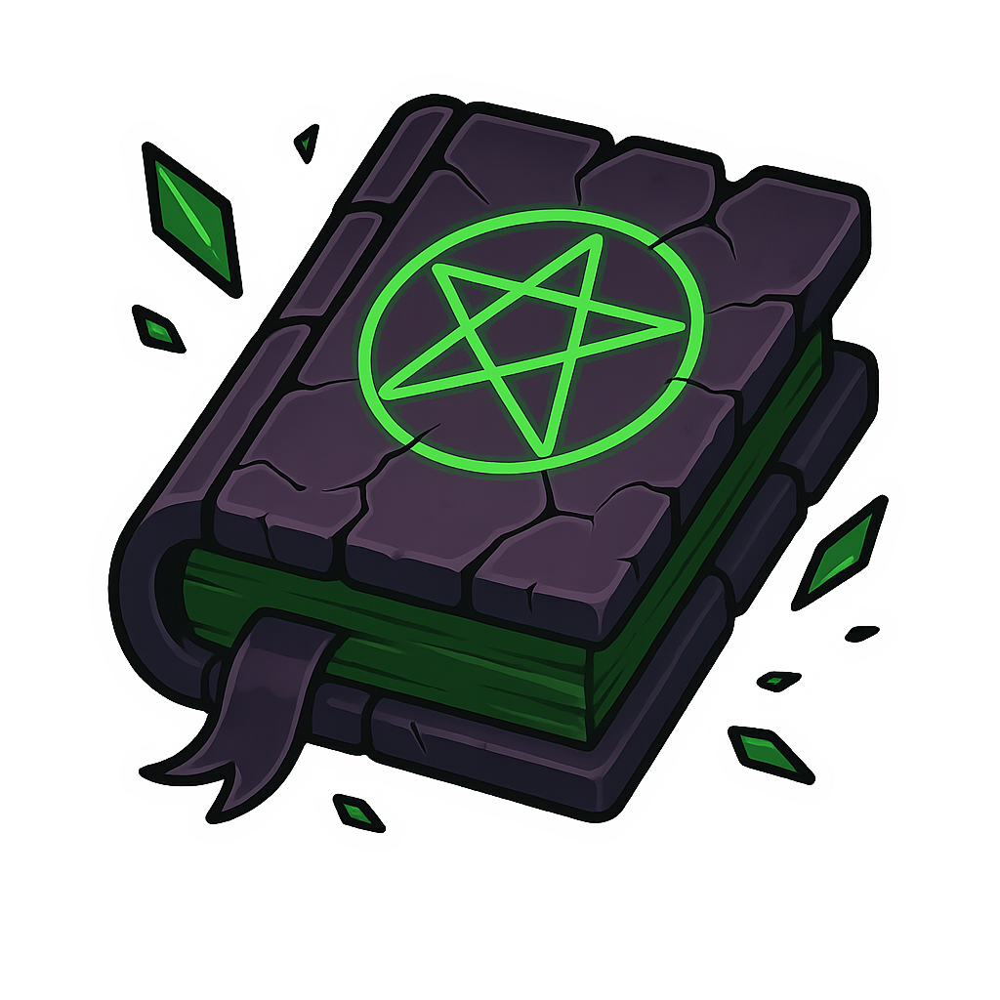
</p>

# SC - Item Rarity Colors


[](https://www.patreon.com/c/shatteredcodex)
[](https://wiki.shattered-codex.com/modules/sc-item-rarity-colors)
[](https://discord.gg/6mWCQEJEwG)


Color item rarities and spells in D&D 5e, with full control for item sheets, actor inventories, and the Foundry item directory.

Compatible with **Foundry VTT v13 and v14**.

## What This Module Does

- Lets you configure colors and effects for each rarity in one place.
- Supports gradient and glow effects where available.
- Works with both default D&D 5e sheet and Tidy sheet.
- Includes built-in theme presets for item rarities, with manual overrides whenever you want a custom look.
- Applies visuals to:
  - item sheets
  - actor inventory rows
  - Foundry item directory rows
- Includes a rarity list manager (add, remove, rename, reorder, show/hide).
- Plays nicely with Custom DND5E rarity data when both modules are active.
- Includes Spell School color configuration for spells, built-in spell theme presets, and optional per-level variants.
- Gives unidentified items their own style, so their colors do not reveal the real rarity, and can hide their image too: shadowed, as a silhouette, blurred, or swapped for a stand-in image per kind of item (swords, axes, armor, rings, potions, and so on), with an optional question mark over it.

---

## Installation

1. In Foundry VTT, go to **Add-on Modules → Install Module**.
2. Paste this manifest URL:
   `https://github.com/Shattered-Codex/sc-item-rarity-colors/releases/latest/download/module.json`
3. Install and enable **SC - Item Rarity Colors** in your world.

Compatible with **Foundry VTT v13 and v14** and **dnd5e**.

---

## Configuration Screens

Open:
**Configure Settings → Module Settings → SC - Item Rarity Colors**

The module shows three buttons there — **Open settings**, **Configure items**, and **Configure spells** — followed by links to the wiki, Patreon, and Discord.

### Module Settings Window

**Open settings** groups the module options in one window:

- **Rarity list** — add, rename, reorder (drag), or hide rarities.
- **Unidentified items** — choose who sees the unidentified style: players, everyone, or nobody.
- **Integrations** — copy rarity colors to **Tidy 5e Sheet** while Tidy is active.
- **Animations** — disable animated effects for this browser. Effects also respect reduced-motion preferences.
- **Diagnostics** — enable debug logs for this browser.

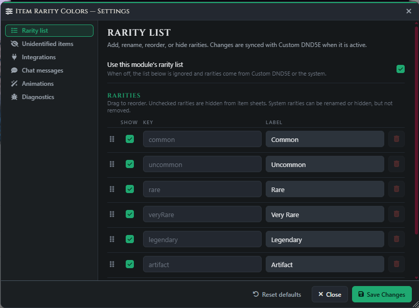

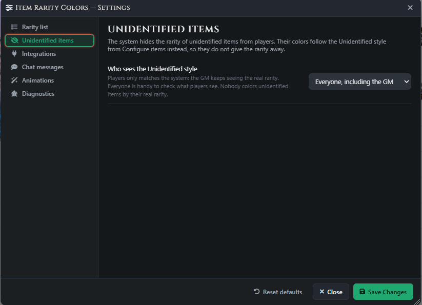

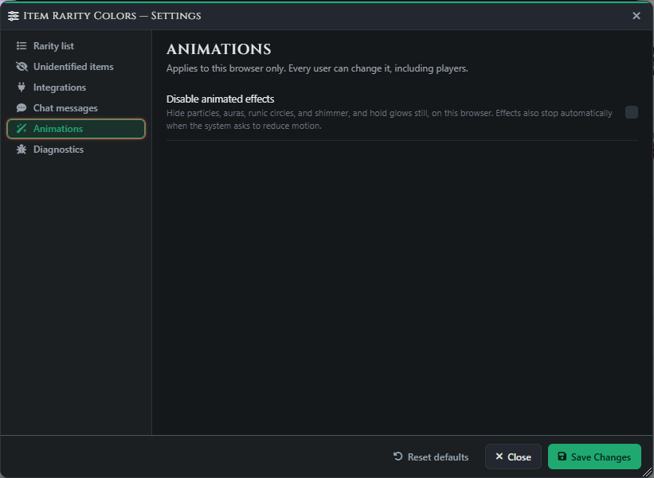

### Item Colors and Theme Presets

Open **Configure items**, select a rarity, and use the **Colors** tab to adjust its item sheet, inventory, and sidebar appearance. Choose a built-in theme preset to apply a palette across the built-in rarity tiers, then fine-tune individual fields.

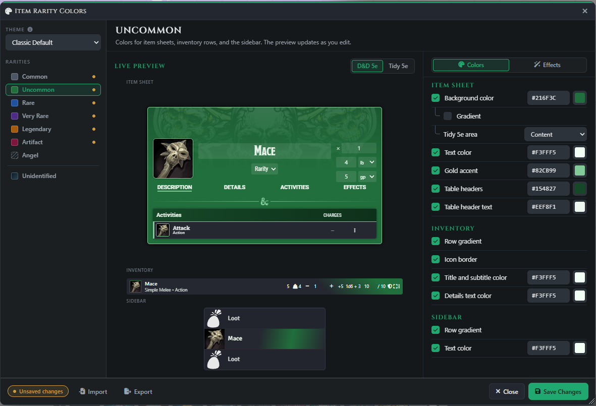

### Animated Effects

Use the **Effects** tab to configure auras, particles, waves, and icon effects. The previews show the selected rarity's appearance on each surface.

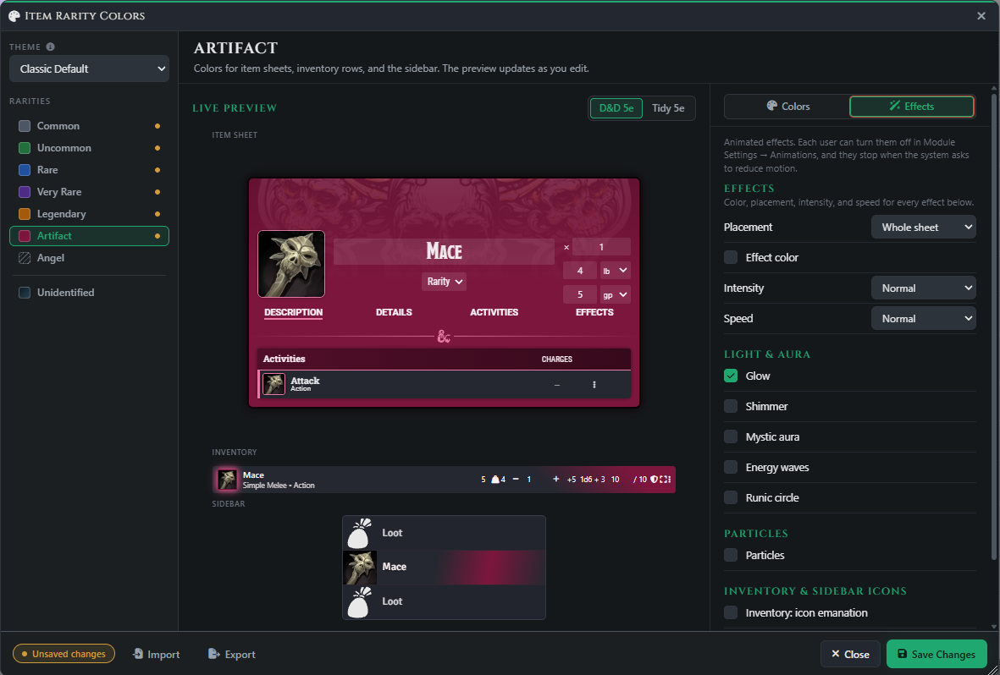

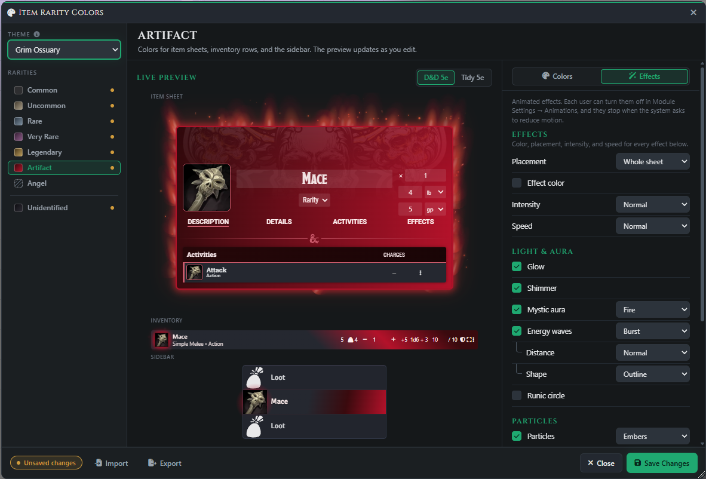

### Unidentified Items

The D&D 5e system controls whether an item is identified. Select **Unidentified** at the bottom of the rarity list to configure the style used in place of its real rarity.

Its **Image** tab can show the real image, darken it with **Shadowed** (the default), draw a **Silhouette**, blur it, or replace it with an image **By item type**. Choose your own images for swords, axes, armor, rings, potions, and other categories with the file picker.

You can add a question mark and choose whether the image treatment applies to item sheets, inventories, and the sidebar and compendiums. These changes affect the on-screen appearance; the item's stored image stays unchanged.

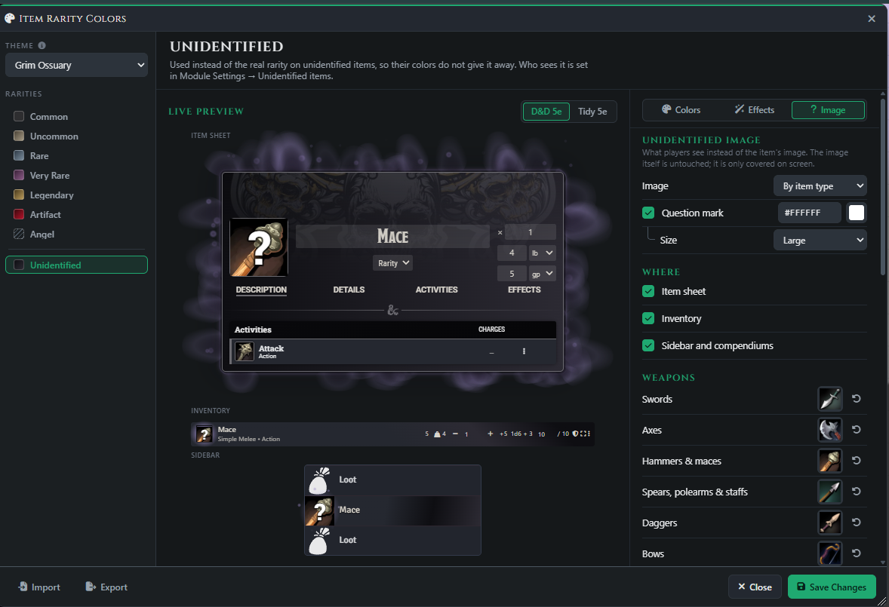

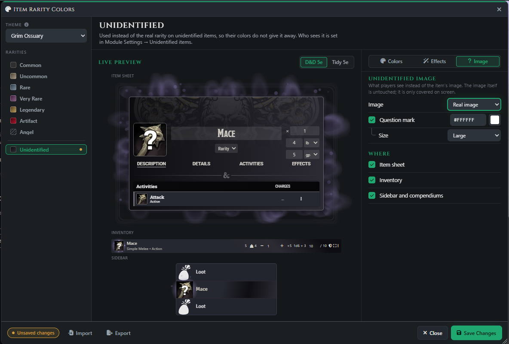

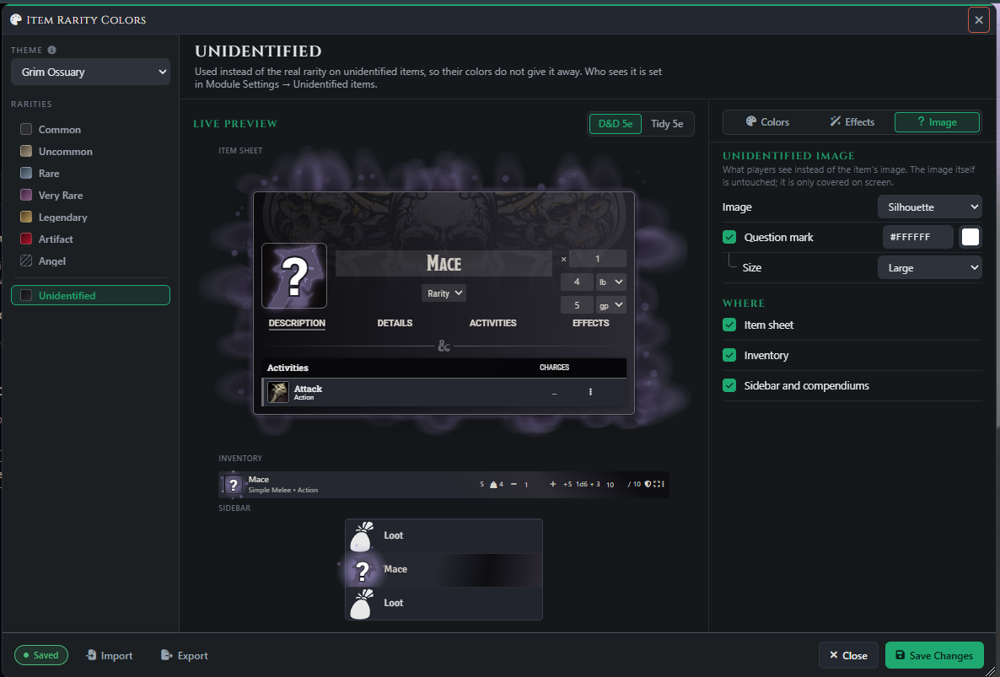

### Spell School Colors

Open **Configure spells** to style spells by **magic school**. Enable **level variants** to configure each combination of school and spell level. Built-in spell theme presets provide a starting palette before individual adjustments.

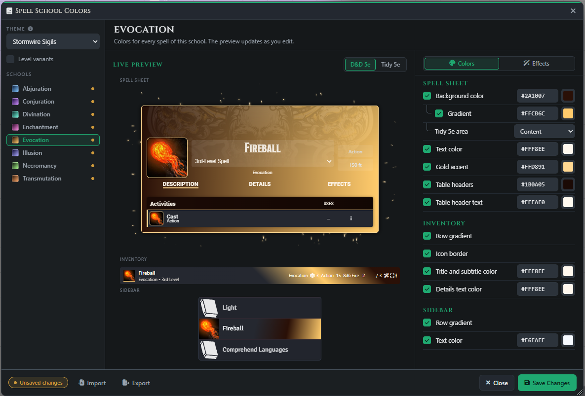

### Tidy 5e Previews

Switch the editor preview to **Tidy 5e** to check colors and effects against Tidy's layout. The Tidy-specific controls are available while Tidy is active.

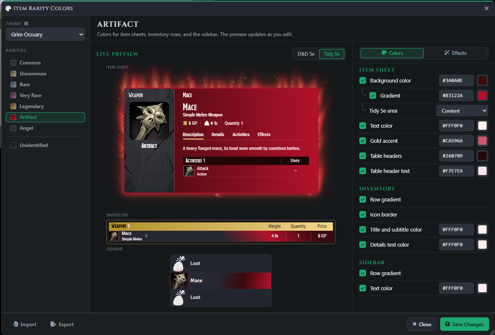

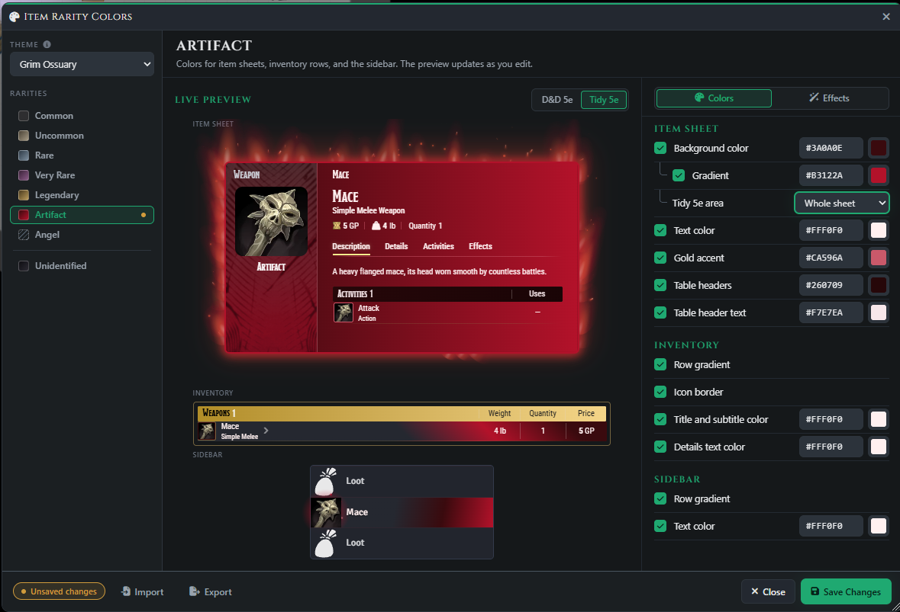

---

## In-Game Results

### D&D 5e Item Sheet

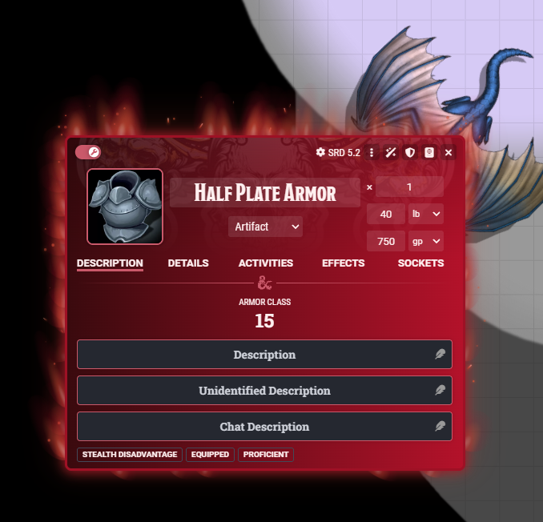

### D&D 5e Spell Sheet

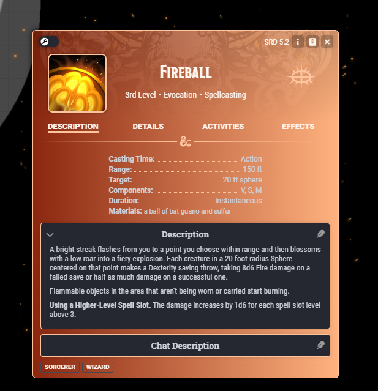

### Tidy 5e Unidentified Item

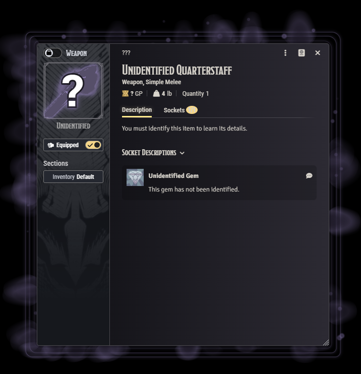

### Foundry Items Directory

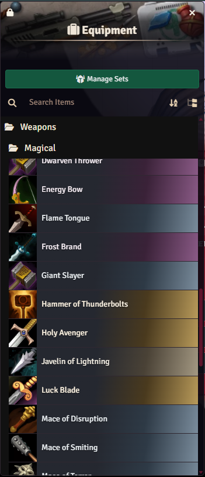

---

## Public API

Other modules can style their own item rows the way this module styles actor inventory rows. The API is
published at `init` and versioned; check `version` before calling it.

```js
const api = game.modules.get("sc-item-rarity-colors");
if (api?.active && api.api?.version >= 1) {
  api.api.styleItemRow(rowElement, item, { imageSelector: ".my-icon > img" });
}
```

`styleItemRow(row, item, { imageSelector = "img" })` applies the item's rarity (or spell) gradient and text colors to
`row`, and the border, icon effects, and unidentified image cover to the image matched by `imageSelector`. An item that
is unidentified to the current user gets the **Unidentified** style, so its rarity is not revealed. It is safe to call
again after each render.

- Title colors reach `.item-name` and `.item-type` inside the row; details colors reach `.item-detail` and
  `.item-quantity`.
- The image needs a positioned parent (`position: relative`), since its cover and effects are placed beside it.

---

## Notes

- Rarity visuals are configurable per rarity tier.
- Built-in presets are available for both item rarity themes and spell school themes.
- You can keep your rarity list minimal or fully custom.
- If Custom DND5E is enabled, rarity data can stay synchronized.
- Supports Foundry VTT **v13** and **v14**.

---

## Support and Feedback

Thank you for using **SC - Item Rarity Colors**.

If this module helps your table, please consider supporting **Shattered Codex** on Patreon:  
https://www.patreon.com/c/shatteredcodex

For bugs, ideas, or suggestions, feel free to open an issue anytime:  
https://github.com/Shattered-Codex/sc-item-rarity-colors/issues
